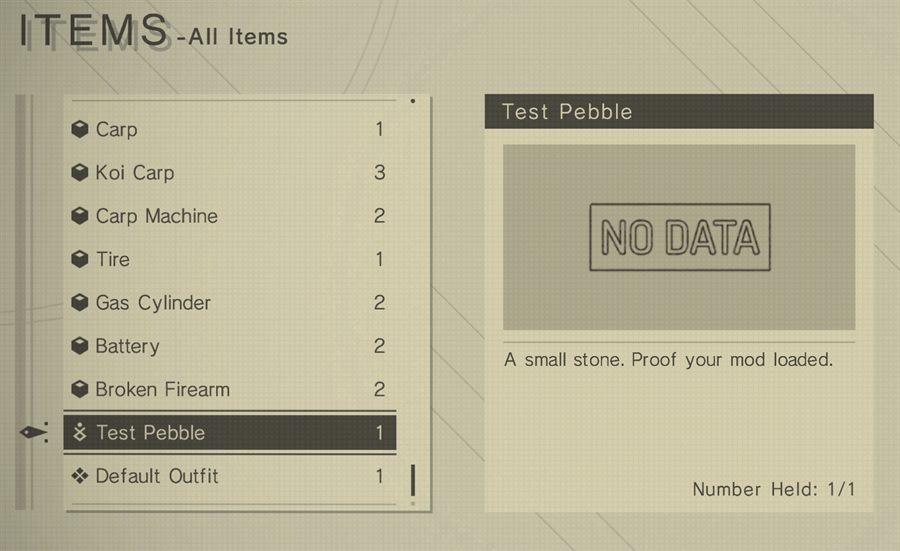

# How to make an item

An item is an entry in the inventory list. Every item is a row of one
item table, which is read once at startup. NAMS reads a small text file
from your mod folder and adds your item to that table while it is read,
so no data file on disk changes. How a mod folder is built is in
[How to lay out your mod folder](02_mod_folder_layout.md).

## "I want an item. What is the fastest way?"

<!-- yp:item-builder -->

The launcher shows a form here. Fill in **Name in the menu** and
**Description**, pick the **Mod folder**, and click **Create the item**.
The launcher picks an **Item id** that no other `item_<id>.toml` in your
mods folder uses, and writes the file; the message reads
`Written to <path>`.

## What is in the file, line by line?

```toml
name = "item_rusty_bolt"
id_type = 0

[auto_give]
quantity = 1

[text.name]
_us = "Rusty Bolt"

[text.help]
_us = "A bolt. It has seen better days."
```

`name` is the item's internal name. A shop finds the item by it, so
give every item its own. It is not the text in the menu; that is
`[text.name]`. The form builds it from **Name in the menu**: `item_`,
then the name's letters `a`-`z` and digits in lowercase, joined by `_`.
Vanilla names look like `item_rec_S`; no prefix is required.

`id_type` is the item type. `0` is the consumable type, which also
holds materials and key items.

`[auto_give]` hands the player `quantity` of the item every time a save
finishes loading. Without it the item exists but nobody has one.

`[text.name]` is the name in the menu, `[text.help]` its description.
`_us` means English.

The number 8500 appears nowhere in the file. It comes from the file
name, `item_8500.toml`.

Save it, restart, and load a save: the item is in the inventory - with
the placeholder icon until you give it one.



## Which number should it have?

Vanilla item ids end at 8041 (the last fish), and the archive entries
start at 1020010, so a number from 8042 to 1020009 belongs to no
vanilla item. NAMS' own **Default Outfit** item uses 999990. If two
mods use the same number, NAMS keeps one, skips the other, and the log
names both.

## How does the player get it?

`[auto_give]` is the simplest way, and the form writes it while
**Give it to the player automatically** is on. An `[[auto_give]]` entry
with an `item_id` and a `quantity` (default `1`), in a file of its own
whose name has no underscore, does the same for any item a mod adds and
for the ids in [vanilla item ids](resources/vanilla_item_ids.md).

The other two ways:

**A shop.** Give the item a `buy` price (see the table below), then add
a second file that puts it on a shelf:

```toml
# entities\shops.toml
[[shop_item]]
shop_name = "shop_RC_Grocery"
item_id = 8500
state = 0
```

`shop_name` is an existing shop's internal name, see
[vanilla shop names](resources/vanilla_shop_names.md). `item_id` must be
an item a mod adds: a vanilla item id is accepted, but the shop does not
list it. `state` must be a number from `0` to `6`; the shop lists the
item whatever the state, so one entry per shop with `0` is enough. Name
the file without an underscore (see
[how to lay out your mod folder](02_mod_folder_layout.md)); several
`[[shop_item]]` blocks can share one file. A `[[shop_item]]` written
into the item file is ignored.

**A quest reward.** Reference the item id from a `reward_*.toml`. See
[how to make a reward](09_reward.md).

## Why does it not show up?

Conflicts and skipped entries appear in the log with a `[NAMS]` prefix
and say what to fix. Broken files appear with a `[Native]` prefix and
name the file. More in [how to debug](17_debugging.md).

**The item is not in the inventory.**

- The item table is read at startup, and `[auto_give]` hands the item
  over when a save finishes loading: restart, then load a save.
- Two mods use the same number. The log reads
  `[NAMS] Two mods try to use the same item_bundle number '8500'.`,
  followed by the mod that was kept and the one that was skipped. Give
  one of the items another number.
- The file was not accepted. The log reads
  `[Native] <path> [item_bundle]: parse item_bundle: <what is wrong>`.
  A TOML syntax error reads `[Native] Failed to parse <path>: <error>`.
- A misspelled field or table name is ignored without a log line,
  `[auto_give]` included.
- `custom_items = false` in the `[content]` table of `nams.toml` skips
  every mod item without a log line, see [nams.toml](13_nams_toml.md).
- A vanilla item of the same `id_type` already has the number: the
  vanilla item keeps it, and yours is not added.

**The name or description is missing.** NAMS adds the text of the
player's language only, see the language section below.

**The icon is the placeholder.** The texture name does not resolve, and
no log line says so. Check that the pair sits in your mod's
`data\misctex\`, that both files start with `misctex_`, and that
`misctex_name` leaves out `misctex_` and the extension.

**The shop does not list it.**

- `shop_items = false` in the `[content]` table of `nams.toml` skips
  every shop entry.
- An `item_id` that no mod loads, or a `shop_name` that is not a shop:

  ```
  [NAMS] Skipping shop_item 'shop_RC_Grocery:8500:0' from mod 'my_mod' because the item '8500' it depends on (from mod '<unstaged>') is not loaded.
  ```

  For a wrong shop name the line reads `the shop '<shop_name>'` instead.
- A `state` outside `0` to `6`:

  ```
  [NAMS] Register failed for shop_item from mod 'my_mod': shop_item state <state> out of range (must be 0..=6)
  ```
- The `[[shop_item]]` sits in the item file, or `item_id` is a vanilla
  item.

**A change made while running does not show.** Saving an item file
registers it again, and the log reads
`[NAMS] hot register <path>: 1 registered, 0 failed, 1 purged`. The name
and description change in place. A new item, and changes to `id_type`,
`category`, `max_num` and the prices, are read only at startup: restart.

## What else can I set?

All optional. Leave them out and you get the default.

| Field | Default | What it does |
|---|---|---|
| `max_num` | `1` | How many the player can carry. |
| `no_trash` | `false` | A yes/no flag stored in the item's row of the item table. The form writes `true` while **Can be sold** is off. |
| `die_discard` | `false` | A yes/no flag stored in the item's row of the item table. |
| `buy` | `-1` | Purchase price. `-1` means not purchasable. |
| `sell` | `-1` | Sale price. `-1` means not sellable. |
| `category` | `0` | Group within the consumables (`id_type = 0`), `0` to `7`. `0` to `3`: the menu offers **Use**. Any other value: the player keeps the item. `0` also puts an item the player owns into the quick-item menu. |
| `obj_id` | `0` | Object id stored in the item's row of the item table. Leave at `0`. |
| `[effect.<name>]`, `[[effect_array]]` | none | Effect rules, see [how to make special effects](11_special_effects.md). On an item with `id_type = 0` and `category` `0` to `3` a rule runs when the item is used; on any other item it lasts while the player owns at least one. A rule that cannot work for the item is refused, and the log line names the category it needs. |
| `[use_particle]` | `id = 0x1a4`, `target = "player"` | The particle shown when the player uses an item with effect rules. `id` is the particle (`0` shows none), `target` is `"player"` or `"pod"`. |
| `use_sound` | none | Name of a sound played on the player when they use an item with effect rules. |

### What does `id_type` change?

`id_type` decides which item list the item joins:

| `id_type` | List |
|---|---|
| `0` | Consumable / material / key item |
| `2` | Pod program |
| `3` | Plugin chip |
| `4` | Archive entry |
| `5` | Achievement |
| `6` | Storage upgrade |
| `7` | Gallery / fish |

`1` is weapons. Those use `weapon_<id>.toml` instead, see
[how to make a weapon](04_weapon.md). Any other value adds the item to
no list.

### How do I add other languages?

```toml
[text.name]
_us = "Rusty Bolt"
_de = "Rostige Schraube"
_cn = "生锈的螺栓"
```

The suffixes are `_us` (English), `_de` (German), `_fr` (French), `_es`
(Spanish), `_it` (Italian), `_cn` and `_tw` (Chinese, simplified and
traditional) and `_kr` (Korean). Japanese is the empty key `""`.

NAMS uses the text of the player's language only. Chinese and Korean
players get the `_us` text where their own is missing; for every other
language a missing text stays missing. Write `[text.name]` and
`[text.help]` in every language your players use.

NAMS breaks a description into lines of at most 35 characters at the
spaces. A description with line breaks of its own (`\n`) is kept as
written.

### How do I give it an icon?

Ship a `.dat`/`.dtt` texture pair:

```
my_mod\data\misctex\misctex_item_thumb_8500.dat
my_mod\data\misctex\misctex_item_thumb_8500.dtt
```

Then point at it, without the `misctex_` prefix and without the
extension; both are added when the file is looked up:

```toml
[icon]
misctex_name = "item_thumb_8500"
```

Without `[icon]`, NAMS looks up `item_thumb_<id>`, so a pair named after
the item's own id is found without this line too. The form's
**Set an icon** button converts an image and writes the pair and the
`[icon]` line for you.

You can also name a texture another mod ships. If the name does not
resolve, the item still loads with the placeholder icon.
