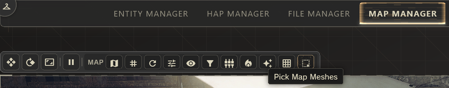
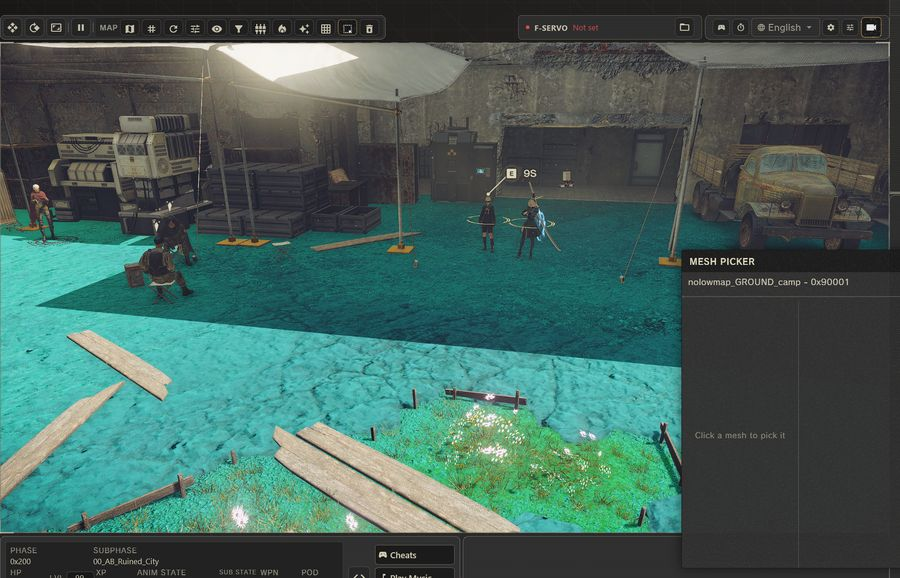
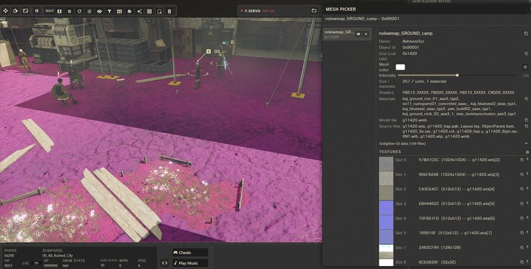
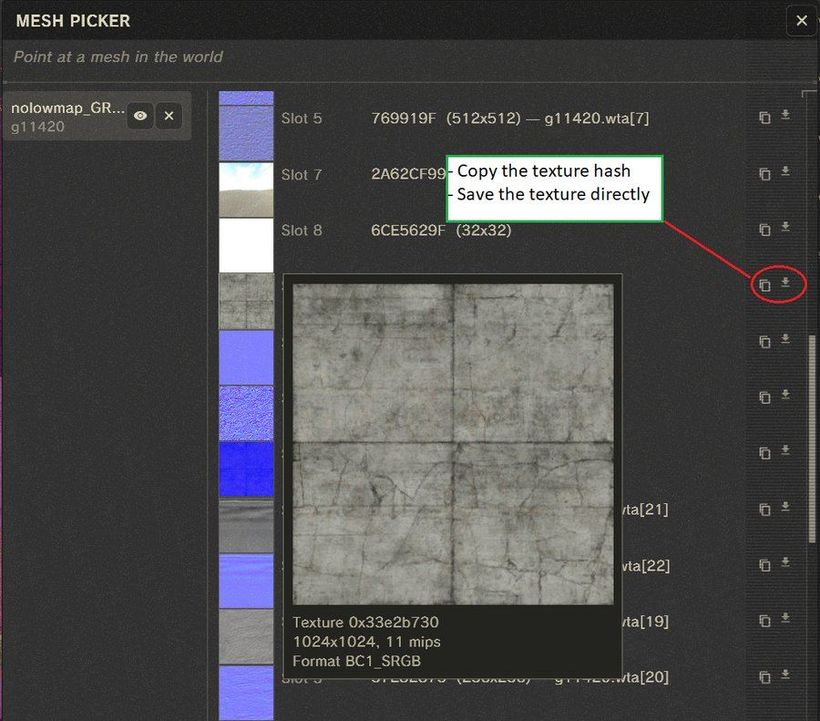

# How to replace textures

NAMS swaps textures while they load. Every texture gets a hash when it
is loaded: an ID number computed from its pixels. A `.dds` file named
after that hash replaces the texture, for example `87F0B90C.dds`. Game
files stay untouched. The hash is the one Special K, a PC modding tool,
uses for its texture packs, and Special K's own folder
`SK_Res\inject\textures\` is read as well.

## "I downloaded a texture pack. How do I install it?"

In the launcher's **Textures** tab, drop the archive or the folder onto
the field **Drop texture folder or archive here**. The launcher copies
it into `nams\inject\textures\` as a pack folder.

By hand: put the pack folder into `nams\inject\textures\`, then open
the launcher's **Textures** tab once, so the folder is added to the
pack list (see "Two packs change the same texture" below).

```
NieRAutomata\
  nams\
    inject\
      textures\
        <pack>\
          87F0B90C.dds
          A006408A.dds
          38BFD9BA.dds
```

Start NAMS. It worked when the log (see
[How to debug when something goes wrong](17_debugging.md)) contains
this line, with your file count:

```
[TEXTURES] Found <files> .dds files (<size> MB), VRAM detected (<vram> MB), preload budget <budget> MB, mode: on-demand
```

The end of the line reads `mode: preload all` or `mode: on-demand`, see
"Textures pop in late" below.

## "I want to retexture something. Which file do I have to make?"

Start NAMS and open the YoRHa Protocol workspace, the in-game devkit,
with `F1`. Open **Map Manager** and in its toolbar click the button
with the tooltip **Pick Map Meshes**.



The **Mesh Picker** window opens. Whatever you point at in the world is
tinted. This works on every model in the world, not only on map
geometry. What you point at is a mesh: one piece of a model. Click to
pick it.



The picked mesh gets its own tint and appears in the window. Under
**Textures** it lists every texture the mesh's materials use, one line
each: a small preview, the hash and the size. The hash is the file name
you need.



Hover the small preview to see the texture larger. The two buttons at
the end of the line do the rest: the first copies the hash, the second
saves the texture to `nams\texture_dump\<hash>.dds`, full size and
already named correctly. **Save all as DDS** next to **Textures** saves
every texture of the mesh at once.



If a line reads `id 0x<number>, not uploaded`, the hash could not be
read: the texture was not on the graphics card at that moment, or
reading it back failed.

## "I edited the file. Where does it go?"

1. Open `nams\texture_dump\87F0B90C.dds` in an image editor that can
   save `.dds`, change it, and save it as `.dds` in `DXT1`, `DXT5` or
   `BC7`. Your file may be bigger than the texture it replaces.
   Mipmaps (the smaller copies an exporter can store inside the file)
   are optional. If the file holds more mipmap levels than the texture
   it replaces, the extra levels are not loaded.
2. Put it into a pack folder of your own:

   ```
   nams\inject\textures\<pack>\87F0B90C.dds
   ```

3. Restart, or keep NAMS running: see the next section.

## "I want to see my changes without restarting."

Save your `.dds` while NAMS runs; once the file has not changed for 0.3
seconds, the new version is loaded. This is called hot reload and is on
by default. It watches
`nams\inject\textures\`, `nams\mods\` and `SK_Res\inject\textures\`.
Every pickup is logged as
`[TEXTURES/reload] <hash> <- <path>`.

- If the file kept its size, its mipmap count and its format, the
  texture is updated right where it is used, including on objects that
  are already on screen. The log adds
  `[TEXTURES/reload] in-place update applied <hash>`.
- If you changed the size, the mipmap count or the format, the new
  version is used for everything loaded from now on; copies already in
  use keep the old image until the area is loaded again. The log says
  `shape changed`.
- A brand-new file is picked up as well and loads the next time that
  texture is loaded.

The file you saved last stays the active one for that hash until NAMS
is restarted, no matter which pack it is in.

## "I put my file in and nothing changed."

- **The startup line does not count your file.** The file is not under
  `nams\inject\textures\`, or its pack folder is missing from
  `load_order` (see "Two packs change the same texture" below), or its
  pack is switched off in the launcher profile, or the name is not a
  hash. The name is the hash as the Mesh Picker shows it, plus `.dds`;
  anything after a `_` in the name is ignored. `38BFD9BA 2k.dds` (a
  space and a suffix) is ignored without a log line; `38BFD9BA.dds`
  works.
- **Counted, but nothing changes.** The hash is not the one of that
  texture. Pick the mesh and compare the hash with your file name. With
  `mode: preload all`, a file that cannot be read is also counted, but
  skipped without a log line: check it as in the next point.
- **Another pack's version shows.** Move your pack up in the launcher
  list (see "Two packs change the same texture" below).
- **The log says `[TEXTURES/async] read failed` or `parse failed` next
  to your hash.** The file is broken or saved in an unsupported way;
  the message names the reason (`Unknown FourCC`, `Unsupported
  uncompressed format: N bits`, `Invalid DDS magic`). Save it again as
  `DXT1`, `DXT5` or `BC7`.
- **It shows late when you enter an area.** With more than 400 files,
  or files bigger than the preload budget, the replacements are loaded
  while you play, so a texture can appear a moment after the area does.
  That is normal; see "Textures pop in late" below.

## "My textures should only show together with my outfit mod."

This needs an outfit mod, see [How to make an outfit](05_outfit.md)
and [How to lay out your mod folder](02_mod_folder_layout.md). Put
the textures into the mod's own `textures` folder instead of a pack:

```
nams\mods\<mod>\
  data\pl\pl0000.dat        the 2B model
  textures\87F0B90C.dds     shown only while 2B wears this mod's outfit
```

Which character the mod dresses is read from the model files under
`data\pl\`:

| File present | Character |
|---|---|
| `pl0000.dat` or `pl000d.dat` | 2B |
| `pl0100.dat` or `pl010d.dat` | A2 |
| `pl0200.dat` or `pl020d.dat` | 9S |

While the outfit is worn, these textures win over every pack for the
same hash. When the character changes outfit, the packs take over
again (log: `[TEXTURES] outfit change (...): N texture hashes
re-resolved`). A mod with models for several characters shows its
textures while any of them wears it.

## "Two packs change the same texture. Which one shows up?"

The one higher in the launcher's Textures list. Drag to reorder; the
top entry is marked HIGHEST, the bottom one LOWEST. Packs that share
textures with another pack carry the label OVERLAP.

The full order:

```
NieRAutomata\
│
├─ SK_Res\inject\textures\             (1) Special K's own folder, if you have one
│
└─ nams\inject\textures\
     ├─ 87F0B90C.dds                   (2) files lying loose in the folder
     ├─ <pack A>\87F0B90C.dds          (3) the top pack in the launcher list
     └─ <pack B>\87F0B90C.dds          (4) the next pack in the list

Same hash in several places: the first one in the order (1) to (4)
is used, the others are ignored. In this example without (1), the
loose file wins, pack A and pack B lose.
```

The launcher stores the list order in `nams\texture_injection.toml`
under `load_order`; the first name in that list is the top pack. While
`load_order` lists packs, only the packs it names are read; a listed
folder that does not exist logs `[TEXTURES] load_order pack not found`.
While `load_order` is empty, everything inside `nams\inject\textures\`
is read, subfolders included. A pack switched off in a launcher profile
is listed under `disabled_packs` in the same file and skipped
completely (log: `skipping disabled pack (config)`).

## "Textures pop in late, or the picture stutters with a huge pack."

At startup NAMS decides between two ways of loading:

- **Everything at startup** (`mode: preload all` in the log): at most
  400 files, and their total size fits into the preload budget the log
  line shows. Replacements are there from the start.
- **While you play** (`mode: on-demand`): bigger packs. The texture
  being replaced shows first, a background thread loads yours and swaps
  it in. When the replacement budget is full, NAMS drops replacements
  to make room: first those from folders lower in the order, then those
  not in use, the longest unused first. A dropped replacement that was
  in use shows the replaced texture until the area is loaded again. Replacements on the built-in relevance list (while
  `pin_priority_textures = true`) and the textures of a worn outfit mod
  are never dropped.

This is the settings file, `nams\texture_injection.toml`, with its
defaults. The launcher edits the five settings with a label for you
under **Textures** (labels in brackets) and writes the two lists
itself. Changes apply at the next start.

```toml
# Memory for replacement textures in MB. 0 = decide from the graphics card. [VRAM Budget (MB)]
vram_budget_mb = 0

# true = start the background loader at startup. [Background Loading]
# false = it is started only by hot reload; with both off, replacements
#         are only loaded in mode: preload all.
streaming_enabled = true

# true = from a texture folder with 400 or more .dds files, load only the textures on the
# built-in relevance list (explained below). Smaller folders are always loaded completely. [Load Only Relevant]
load_only_relevant = false

# true = load the replacements for the built-in relevance list at startup and never drop them.
# false = they are dropped like every other replacement when the budget is full. [Keep Priority Textures Loaded]
pin_priority_textures = true

# Pack folders inside nams\inject\textures\, top of the launcher list first. Written by the launcher.
load_order = []

# Pack folders to skip. Written by launcher profiles.
disabled_packs = []

# Pick up .dds files you save while NAMS runs. [Hot reload]
hot_reload = true
```

With `vram_budget_mb = 0` (**Auto (recommended)** in the launcher),
NAMS takes the memory budget the graphics card reports, keeps 1 GiB
plus 128 MiB free, and uses the rest (at least 1 GiB, at most 16 GiB)
for replacements. A number of MB sets the limit instead; values below
1024 count as 1024, values above 16384 as 16384. While NAMS runs,
replacements never take more than the card has free.

The relevance list behind `load_only_relevant` and
`pin_priority_textures` is a fixed list of hashes built into NAMS. If
your own pack replaces textures that are not on that list, leave
`load_only_relevant` off.

## "How do I turn texture replacement off?"

For one pack: switch it off in the launcher profile. For everything:
turn on **Disable Texture Injection** in the launcher's NAMS tab, or
set in `nams\nams.toml`

```toml
disable_texture_injection = true
```

It applies at the next start; the log then says
`Texture injection disabled via nams.toml`.

## What may a `.dds` contain?

| Saved as | Works |
|---|---|
| `DXT1`, `DXT3`, `DXT5` | yes |
| `ATI1` / `BC4U`, `ATI2` / `BC5U` | yes |
| `BC7` and the other block-compressed formats in a DX10 header, sRGB variants included | yes |
| uncompressed 32-bit RGBA or BGRA | yes |
| uncompressed 24-bit, 16-bit, 8-bit | no: `Unsupported uncompressed format` |

Any width, height and mipmap count. If the file is shorter than its
header promises, the mipmaps that are there are used, as long as the
full-size level is complete.
